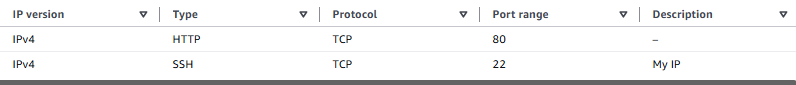
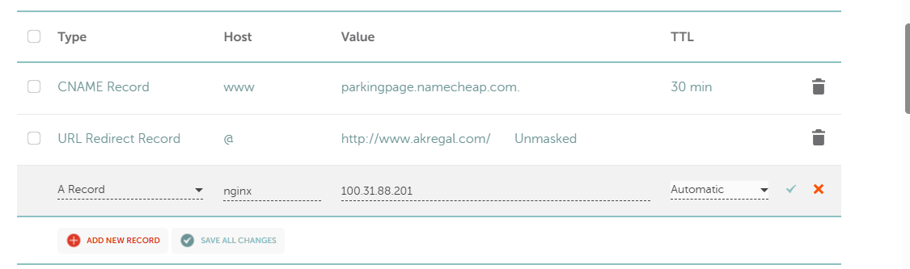
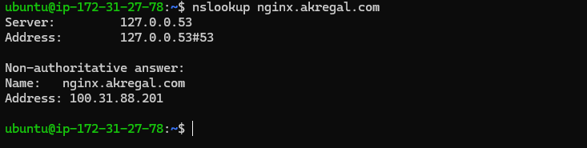
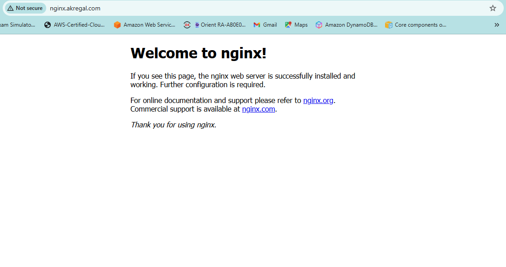

# Networking Project: Deploying NGINX on AWS EC2 with Custom DNS

## Objective

Deploy an NGINX web server on an AWS EC2 instance and make it accessible over the internet using a custom domain name.

**Domain:** `nginx.akregal.com`

This project demonstrates how DNS, IP addressing, HTTP, security groups and cloud infrastructure work together to make a website publicly accessible.

## Requirements

- Launch an AWS EC2 instance running Ubuntu.
- Configure inbound security group rules for SSH and HTTP.
- Connect to the EC2 instance using SSH.
- Install and run NGINX.
- Configure a DNS A record pointing to the EC2 public IPv4 address.
- Verify DNS resolution using `nslookup`.
- Confirm that the NGINX welcome page loads through the custom domain.

## 1. Launching an AWS EC2 Instance

Created an Ubuntu EC2 instance to host the NGINX web server.

The instance was assigned a public IPv4 address, allowing it to be reached over the internet.

Connected to the instance remotely using SSH from my local WSL terminal.

Example SSH command:

```bash
ssh -i ~/.ssh/YOUR_KEY.pem ubuntu@YOUR_EC2_PUBLIC_IP
```

**Key concepts:**

- **EC2:** A virtual server hosted in AWS.
- **Public IPv4:** An address used to reach the instance over the internet.
- **SSH:** A protocol for securely accessing and managing remote machines.

## 2. Configuring Security Groups

Configured the EC2 security group to allow the required inbound traffic.

| Type | Protocol | Port | Source |
|---|---|---|---|
| SSH | TCP | 22 | My IP (/32) |
| HTTP | TCP | 80 | Anywhere IPv4 (0.0.0.0/0) |

**Why these rules?**

- **SSH (22):** Allows remote administration. Restricting access to my public IP reduces unnecessary exposure.
- **HTTP (80):** Allows visitors to access the NGINX web server from the internet.

AWS security groups act as virtual firewalls, controlling permitted inbound and outbound traffic.



## 3. Installing and Running NGINX

Once connected to the EC2 instance, updated the Ubuntu package lists:

```bash
sudo apt update
```

Installed NGINX:

```bash
sudo apt install nginx -y
```

Enabled NGINX to start automatically at boot and started the service:

```bash
sudo systemctl enable --now nginx
```

Verified that the service was running:

```bash
sudo systemctl status nginx
```

### Testing HTTP Connectivity

Entered the EC2 instance's public IPv4 address into a browser using HTTP.

The default NGINX welcome page loaded successfully.

This confirmed that:

- NGINX was serving web content.
- The EC2 instance was accessible through its public IPv4 address.
- Incoming HTTP traffic on port 80 was permitted.

## 4. Configuring DNS

Created an A record using Namecheap's DNS management interface.

| Field | Configuration |
|---|---|
| Record Type | A |
| Host | nginx |
| Value | EC2 public IPv4 address |
| TTL | Automatic |

The A record maps `nginx.akregal.com` to the EC2 instance's public IPv4 address.



### Why an A Record?

An A record maps a hostname to an IPv4 address.

Instead of remembering the server's numerical IP address, visitors can use a readable domain name.

DNS provides the IP address required to establish a connection to the server.

## 5. Testing DNS Resolution

Used `nslookup` to check whether the domain resolved to the expected EC2 public IP address.

```bash
nslookup nginx.akregal.com
```

The command returned the EC2 instance's public IPv4 address, confirming successful DNS resolution.



### Understanding the Output

- **DNS resolver:** The server responsible for handling the DNS query.
- **Non-authoritative answer:** The response was not provided directly by the domain's authoritative nameserver.
- **Address:** The IPv4 address associated with the hostname.

## 6. Testing the Website

Opened the following address in a browser:

`http://nginx.akregal.com`

The default NGINX welcome page loaded successfully.



This confirmed that the domain resolved to the correct EC2 instance and that the web server successfully responded to HTTP requests.

**Note:** The deployment uses HTTP rather than HTTPS, as required by the assignment. HTTPS would require additional configuration.

## Key Learnings

### 1. DNS Resolution and HTTP Are Separate Processes

DNS translates a domain name into an IP address.

Once the browser obtains the destination IP address, it establishes a connection to the web server.

The HTTP request does not normally travel through the DNS resolver.

### 2. Security Groups Control Network Access

AWS security groups determine which network traffic is permitted to reach an EC2 instance.

Different services use different ports:

- SSH uses TCP port 22.
- HTTP uses TCP port 80.
- HTTPS typically uses TCP port 443.

Only the necessary ports should be exposed, with administrative access restricted wherever possible.

### 3. Public IP Addresses Can Change

An automatically assigned EC2 public IPv4 address can change when an instance is stopped and started.

If this happens, the existing DNS A record may point to an outdated address.

The A record must then be updated to reflect the new public IP.

An Elastic IP provides a static public IPv4 address, although AWS charges for public IPv4 usage.

### 4. DNS Records Connect Hostnames to Services

The hostname identifies which domain or subdomain is being configured.

The A record's value specifies the destination IPv4 address.

For this project:

- **Hostname:** `nginx.akregal.com`
- **Destination:** EC2 public IPv4 address

### 5. Testing Components Independently Helps Troubleshooting

Testing the NGINX server through its public IP before configuring DNS helped verify that HTTP connectivity worked independently.

Using `nslookup` afterwards confirmed that the domain resolved correctly.

Finally, testing the domain in a browser verified that both components worked together.

## Challenges and Troubleshooting

### Challenge 1: Understanding DNS Record Configuration

Initially, I confused the hostname and destination IP address when configuring the A record.

**Resolution:**

I learnt that the hostname specifies the domain or subdomain, while the record's value specifies the destination IP address.

### Challenge 2: Understanding DNS and HTTP Traffic

Initially, I assumed that HTTP requests travelled through DNS servers because the domain's IP address was configured there.

**Resolution:**

I learnt that DNS resolves the hostname into an IP address, while HTTP handles communication between the browser and the web server.

### Challenge 3: Securing SSH Access

Initially, SSH was configured to accept connections from anywhere (`0.0.0.0/0`).

**Resolution:**

Updated the security group to restrict SSH access to my public IP using a `/32` CIDR range.

This reduced unnecessary exposure while maintaining remote administration access.

## Outcome

Successfully deployed an NGINX web server on AWS EC2 and made it accessible using a custom domain name.

Verified:

- HTTP connectivity to the EC2 instance.
- Successful NGINX installation and operation.
- DNS A record configuration.
- DNS resolution using `nslookup`.
- Website accessibility through `nginx.akregal.com`.
- Restricted SSH access through the EC2 security group.

The EC2 instance was subsequently stopped to reduce ongoing costs, so the website is not intended to remain continuously available.

This project strengthened my practical understanding of DNS, Linux administration, HTTP, AWS networking and cloud security.

