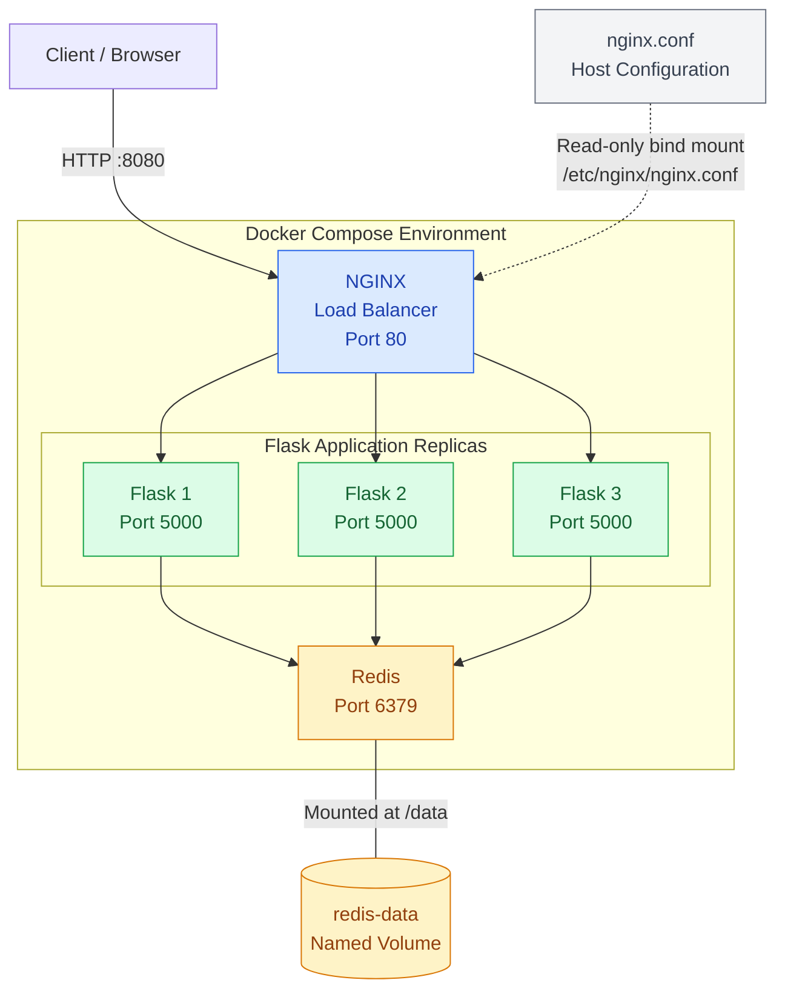

# TrackCount — Docker Multi-Container Application

## 1. Project Overview

**TrackCount** is a three-page Flask web application that demonstrates how to build and manage a multi-container application using Docker and Docker Compose. Visitors can explore the architecture and increment a shared visit counter, while the Count page identifies the Flask container serving each request.

The application consists of three services:

- **Flask** → A Python web application that handles HTTP requests and communicates with Redis.
- **Redis** → A shared data store used to maintain a visit counter.
- **NGINX** → A load balancer that distributes incoming requests across Flask containers.

The project covers containerisation, Docker Compose, service discovery, persistent storage, environment variables, load balancing, and Jinja2-based frontend integration.

### Demo video

[▶ Watch the TrackCount demo](demo/TrackCount-Demo.mp4)

The demo walks through the Home, About and Count pages, showing the shared counter and responding Flask container hostname. The video is stored in the repository so the link works on GitHub after the files are pushed.

## 2. Application Architecture

The diagram below represents the **completed** application. The implementation sections document how this architecture was built incrementally.



**Architecture overview**

- **Browser** → Connects to NGINX through host port `8080`.
- **NGINX** → Distributes HTTP requests among the three Flask replicas.
- **Flask** → Handles application requests and communicates with Redis over the Compose network.
- **Redis** → Stores the shared visit counter, with `/data` mounted to a named volume.
- **NGINX configuration** → Comes from a read-only bind mount of the local `nginx.conf` file.

## 3. Implementation

The project was developed incrementally, with each stage introducing additional Docker and container orchestration concepts.

The implementation began with containerising a Flask application and progressed to integrating Redis, configuring persistent storage, establishing container networking, and implementing NGINX load balancing across multiple Flask replicas.

The following sections document each stage, including the relevant configurations, technical explanations, key learnings and some personal reflections.

> **Documentation note:** The early versions below reconstruct the progression of the project from the development notes; they are not claimed to be exact historical Git snapshots. The final configurations match the completed project.

### 3.1 Containerising Flask and Redis

#### 3.1.1 Creating the Flask application

The initial `flask-app.py` exposed two routes: `/` for a welcome message and `/count` for a counter stored in Redis. At this stage, the Redis hostname and port were written directly into the Python code.

**Initial `flask-app.py`**

```python
from flask import Flask
import redis

app = Flask(__name__)
db = redis.Redis(host="redis", port=6379, decode_responses=True)

@app.route('/')
def hello_world():
    return "Welcome to my Flask and Redis application!"

@app.route('/count')
def count():
    visits = db.incr("visits")
    return f"Visit count: {visits}"

if __name__ == '__main__':
    app.run(host='0.0.0.0', port=5000)
```

- `Flask(__name__)` → Creates the web application.
- `redis.Redis(...)` → Connects to the Redis service using its hostname and port.
- `db.incr("visits")` → Increments the shared counter each time `/count` is requested.
- `host='0.0.0.0'` → Allows Flask to accept traffic through the container's network interface.

#### 3.1.2 Creating the Flask Dockerfile

A separate Dockerfile named `flask-dockerfile` packages the Python application and its dependencies.

**`flask-dockerfile`**

```dockerfile
FROM python:3.14-slim
WORKDIR /app
COPY flask-app.py .
RUN pip install flask redis
EXPOSE 5000
CMD ["python", "flask-app.py"]
```

- `FROM` → Selects the Python base image.
- `WORKDIR /app` → Sets the working directory **inside the image**.
- `COPY` → Copies the application into that directory.
- `RUN` → Installs Flask and the Redis client.
- `EXPOSE` → Documents the port used by Flask; it does not publish that port to the host.
- `CMD` → Starts the application when the container runs.

#### 3.1.3 Creating the Redis Dockerfile

The Redis image uses a separate file named `Dockerfile`.

**`Dockerfile`**

```dockerfile
FROM redis:8.10-alpine
```

**Key learning:** I learned that a Dockerfile defines how an image is built and that paths such as `/app` refer to the image's filesystem, not a directory that must already exist on the host.

### 3.2 Docker Compose Configuration

Docker Compose was introduced to run Flask and Redis together instead of managing each container separately.

#### 3.2.1 Initial configuration and Dockerfile issue

The first attempt used the default Dockerfile for both services. This was a mistake: because the default `Dockerfile` built Redis, the container intended to run Flask was also built from the Redis image.

**Initial problematic `docker-compose.yaml` (reconstructed)**

```yaml
services:
  flask:
    build: .
    ports:
      - "5000:5000"
    depends_on:
      - redis

  redis:
    build: .
```

**Amendment:** I specified `flask-dockerfile` explicitly for the Flask service while leaving Redis configured to use the default `Dockerfile`.

**Complete corrected `docker-compose.yaml`**

```yaml
services:
  flask:
    build:
      context: .
      dockerfile: flask-dockerfile
    ports:
      - "5000:5000"
    depends_on:
      - redis

  redis:
    build: .
```

**What changed**

- `build.context: .` → Uses the project directory as the Flask build context.
- `dockerfile: flask-dockerfile` → Selects the correct Flask Dockerfile.
- `redis.build: .` → Continues using the default `Dockerfile` for Redis.
- `ports: "5000:5000"` → Makes Flask accessible through `localhost:5000`.
- `depends_on` → Starts Redis before Flask, but does not guarantee Redis is ready to accept connections.

The application was started with:

```bash
sudo docker compose up --build -d
```

At this stage, the application was accessible at `http://localhost:5000/`, with the counter at `http://localhost:5000/count`.

**Key learning:** Docker Compose uses a file named `Dockerfile` by default. When services require different Dockerfiles, the intended file must be specified under the relevant service's `build` configuration.

### 3.3 Container Networking and Service Discovery

Docker Compose creates a default network for the application. Containers attached to that network can communicate using their service names.

The Redis connection in `flask-app.py` was:

```python
db = redis.Redis(host="redis", port=6379, decode_responses=True)
```

- `host="redis"` → Uses the Compose service name, resolved through Docker's internal DNS.
- `port=6379` → Connects to Redis on its default internal port.
- `decode_responses=True` → Decodes Redis responses into strings.

The request path at this stage was:

```text
Browser → localhost:5000 → Flask → redis:6379 → Redis
```

Flask needed a published host port so that the browser could reach it. Redis did **not** need a published host port because Flask connected to it over the internal Compose network.

**Key learning:** Internal service-to-service communication uses Docker networking and service names; it does not require publishing every container's port to the host.

### 3.4 Persistent Storage and Environment Variables

Two changes were introduced: a named volume for Redis and environment variables for the Flask-to-Redis connection.

#### 3.4.1 Adding persistent storage

Initially, Redis did not have a dedicated volume. Container filesystem data can be lost when its container is removed.

**Amendment:** I mounted a named volume called `redis-data` at `/data` in the Redis container and declared the volume at the bottom of the Compose file.

**Complete updated `docker-compose.yaml`**

```yaml
services:
  flask:
    build:
      context: .
      dockerfile: flask-dockerfile
    ports:
      - "5000:5000"
    depends_on:
      - redis

  redis:
    build: .
    volumes:
      - redis-data:/data

volumes:
  redis-data: {}
```

**What changed**

- `redis-data:/data` → Mounts the named volume inside Redis at `/data`.
- Top-level `volumes:` → Declares the named volume managed by Docker.

A named volume survives `docker compose down` unless explicitly removed, for example with `down -v`. The volume retains files, but Redis must actually write its data to disk for the counter to persist after container recreation.

#### 3.4.2 Introducing environment variables

The Redis hostname and port were initially hardcoded in `flask-app.py`.

**Amendment:** I imported `os` and replaced the hardcoded Redis connection with values retrieved from `REDIS_HOST` and `REDIS_PORT`. Defaults were provided for both variables.

**Complete updated `flask-app.py`**

```python
from flask import Flask
import redis
import os

redis_host = os.getenv("REDIS_HOST", "redis")
redis_port = int(os.getenv("REDIS_PORT", "6379"))

app = Flask(__name__)
db = redis.Redis(host=redis_host, port=redis_port, decode_responses=True)

@app.route('/')
def hello_world():
    return "Welcome to my Flask and Redis application!"

@app.route('/count')
def count():
    visits = db.incr("visits")
    return f"Visit count: {visits}"

if __name__ == '__main__':
    app.run(host='0.0.0.0', port=5000)
```

**What changed**

- `import os` → Makes environment variables accessible to Python.
- `os.getenv("REDIS_HOST", "redis")` → Reads the Redis hostname, with `redis` as the default.
- `os.getenv("REDIS_PORT", "6379")` → Reads the Redis port, with `6379` as the default.
- `int(...)` → Converts the port value to an integer.

**Amendment:** I then added an `environment` section to the Flask service in Docker Compose so the container would receive those variables.

**Complete updated `docker-compose.yaml`**

```yaml
services:
  flask:
    build:
      context: .
      dockerfile: flask-dockerfile
    ports:
      - "5000:5000"
    depends_on:
      - redis
    environment:
      REDIS_HOST: redis
      REDIS_PORT: "6379"

  redis:
    build: .
    volumes:
      - redis-data:/data

volumes:
  redis-data: {}
```

**What changed**

- `environment:` → Supplies configuration values to the Flask container.
- `REDIS_HOST` and `REDIS_PORT` → Define the connection details without requiring changes to the Python source.

**Key learning:** Named volumes separate data storage from container lifecycles, while environment variables separate application configuration from application code.

### 3.5 NGINX Load Balancer Configuration

Previously, users accessed Flask directly through `localhost:5000`. NGINX was introduced as a single client-facing entry point, with the ability to direct requests to Flask containers.

#### 3.5.1 Adding the NGINX service

**Amendment:** I added an NGINX service, published host port `8080` to its internal port `80`, and mounted the local `nginx.conf` file in read-only mode. I also removed Flask's published port so clients would access the application through NGINX instead.

**Complete updated `docker-compose.yaml`**

```yaml
services:
  flask:
    build:
      context: .
      dockerfile: flask-dockerfile
    depends_on:
      - redis
    environment:
      REDIS_HOST: redis
      REDIS_PORT: "6379"

  nginx:
    image: nginx:alpine
    ports:
      - "8080:80"
    depends_on:
      - flask
    volumes:
      - ./nginx.conf:/etc/nginx/nginx.conf:ro

  redis:
    build: .
    volumes:
      - redis-data:/data

volumes:
  redis-data: {}
```

**What changed**

- `image: nginx:alpine` → Uses the lightweight NGINX image.
- `ports: "8080:80"` → Publishes NGINX on host port `8080`.
- `depends_on: flask` → Starts Flask before NGINX, without guaranteeing application readiness.
- `./nginx.conf:/etc/nginx/nginx.conf:ro` → Bind-mounts the local configuration file as read-only.
- Removing Flask's `ports:` → Keeps Flask accessible internally without publishing it directly to the host.

#### 3.5.2 Creating the NGINX configuration

**Amendment:** I created `nginx.conf` to define an upstream Flask backend and forward incoming HTTP requests to it. The configuration includes Docker DNS resolution so NGINX can resolve the Flask service addresses.

**Complete `nginx.conf`**

```nginx
events {}

http {
    resolver 127.0.0.11 valid=10s;

    upstream flask_backend {
        zone flask_backend 64k;
        server flask:5000 resolve;
    }

    server {
        listen 80;

        location / {
            proxy_pass http://flask_backend;
        }
    }
}
```

**Configuration breakdown**

- `events {}` → Defines the NGINX events block.
- `http {}` → Contains the HTTP configuration.
- `resolver 127.0.0.11 valid=10s;` → Uses Docker's internal DNS resolver and sets a DNS validity interval.
- `upstream flask_backend` → Defines the Flask backend group.
- `zone flask_backend 64k;` → Allocates shared memory for the upstream group.
- `server flask:5000 resolve;` → Resolves the Flask service dynamically on port `5000`.
- `listen 80;` → Accepts HTTP traffic on port `80` inside NGINX.
- `proxy_pass http://flask_backend;` → Forwards matching requests to the backend group.

The client-facing address became `http://localhost:8080/`.

**Key learning:** NGINX acts as a load balancer by receiving incoming requests through one entry point and directing them to the available Flask containers.

### 3.6 Horizontal Scaling and Load Balancing

The next stage involved running three Flask containers and verifying that NGINX distributed requests between them.

#### 3.6.1 Running three Flask replicas

The Flask service was scaled using Docker Compose:

```bash
sudo docker compose up --build -d --scale flask=3
```

- `up` → Creates and starts the services.
- `--build` → Builds service images before starting containers.
- `-d` → Runs containers in detached mode.
- `--scale flask=3` → Starts three replicas of the Flask service.

No further Compose file amendment was required: the Flask service no longer published a fixed host port, so multiple replicas could run without competing for the same host port.

NGINX uses Docker's DNS responses for `flask` to identify backend container addresses. Its default upstream balancing method is round-robin.

#### 3.6.2 Identifying the responding Flask container

To confirm that requests reached different replicas, I updated the homepage to display the hostname of the container handling each request.

**Amendment:** I imported Python's `socket` module and added `socket.gethostname()` to the homepage response. The Redis counter endpoint remained unchanged.

**Complete updated `flask-app.py`**

```python
from flask import Flask
import redis
import os
import socket

redis_host = os.getenv("REDIS_HOST", "redis")
redis_port = int(os.getenv("REDIS_PORT", "6379"))

app = Flask(__name__)
db = redis.Redis(host=redis_host, port=redis_port, decode_responses=True)

@app.route('/')
def hello_world():
    return f"Welcome to my Flask and Redis application! Served by: {socket.gethostname()}"

@app.route('/count')
def count():
    visits = db.incr("visits")
    return f"Visit count: {visits}"

if __name__ == '__main__':
    app.run(host='0.0.0.0', port=5000)
```

**What changed**

- `import socket` → Imports Python's socket module.
- `socket.gethostname()` → Returns the hostname of the responding container.
- The homepage response → Displays that hostname alongside the welcome message.

Refreshing `http://localhost:8080/` displayed different hostnames, confirming that different Flask replicas handled requests.

All three Flask replicas continued using the same Redis service. The shared counter remained accessible at `http://localhost:8080/count`.

**Key learning:** Multiple instances of the same application can receive requests through a single NGINX load balancer while sharing a common Redis backend.

### 3.7 Final Docker Compose Configuration

The final Compose configuration brings together Flask, Redis, NGINX, environment variables, networking, and the Redis named volume. The frontend was added after the infrastructure and scaling stages described above.

**Final `docker-compose.yaml`**

```yaml
services:
  flask:
    build:
      context: .
      dockerfile: flask-dockerfile
    depends_on:
      - redis
    environment:
      REDIS_HOST: redis
      REDIS_PORT: "6379"

  nginx:
    image: nginx:alpine
    ports:
      - "8080:80"
    depends_on:
      - flask
    volumes:
      - ./nginx.conf:/etc/nginx/nginx.conf:ro

  redis:
    build: .
    volumes:
      - redis-data:/data

volumes:
  redis-data: {}
```

Start the completed application with:

```bash
sudo docker compose up --build -d --scale flask=3
```

Access the [homepage](http://localhost:8080/), [About page](http://localhost:8080/about), and [Count page](http://localhost:8080/count).

### 3.8 TrackCount Frontend and Final Flask Application

After validating the container architecture, I built the final TrackCount website with three Jinja2 templates and a shared stylesheet. This stage replaced the earlier plain-text Flask responses with a navigable dashboard-style interface.

**Final application files**

```text
.
├── Dockerfile                 # Redis image
├── flask-dockerfile           # Flask image
├── flask-app.py               # Flask routes and Redis client
├── docker-compose.yaml       # Flask, NGINX and Redis services
├── nginx.conf                 # Reverse proxy and dynamic upstream
├── templates/
│   ├── index.html             # Home page
│   ├── about.html             # Architecture and technology overview
│   └── count.html             # Shared visit counter and hostname
├── static/
│   └── css/
│       └── style.css          # Shared site styling
├── demo/
│   └── TrackCount-Demo.mp4    # Recorded walkthrough
└── README.md
```

**Final `flask-app.py`**

```python
from flask import Flask, render_template
import redis
import os
import socket

# Redis configuration using environment variables
redis_host = os.getenv("REDIS_HOST", "redis")
redis_port = int(os.getenv("REDIS_PORT", "6379"))

# Initialise Flask and Redis
app = Flask(__name__)
db = redis.Redis(
    host=redis_host,
    port=redis_port,
    decode_responses=True
)

# Homepage
@app.route('/')
def hello_world():
    return render_template('index.html')

# Visit counter
@app.route('/count')
def count():
    visits = db.incr("visits")
    return render_template(
        'count.html',
        visits=visits,
        hostname=socket.gethostname()
    )

# About page
@app.route('/about')
def about():
    return render_template('about.html')

# Start Flask application
if __name__ == '__main__':
    app.run(host='0.0.0.0', port=5000)
```

**What changed**

- `/` renders `index.html`, introducing TrackCount and the multi-container architecture.
- `/about` renders `about.html`, explaining the application components.
- `/count` calls `db.incr("visits")`, then passes the updated count and the responding container hostname to `count.html`.
- `static/css/style.css` supplies consistent styling across all three pages.
- `flask-dockerfile` now copies both `templates/` and `static/css/` into the Flask image:

```dockerfile
FROM python:3.14-slim
WORKDIR /app
COPY flask-app.py .
COPY templates/ ./templates
COPY static/css ./static/css
RUN pip install flask redis
EXPOSE 5000
CMD ["python", "flask-app.py"]
```

**Key learning:** A Flask container can serve a styled, multi-page application while remaining stateless between requests. Redis maintains the shared visit counter, and NGINX can route successive requests to different Flask replicas.

**Demo:** [Watch TrackCount in action](demo/TrackCount-Demo.mp4).

## 4. Testing and Validation

The following tests were carried out on the completed application.

### 4.1 Container status

```bash
sudo docker compose ps
```

**Result:** Five containers were running: three Flask replicas, one NGINX container, and one Redis container.

### 4.2 Application accessibility

I opened `http://localhost:8080/`, `http://localhost:8080/about`, and `http://localhost:8080/count` and verified that all three styled pages loaded through NGINX.

**Result:** NGINX successfully forwarded HTTP requests to Flask.

### 4.3 Load balancing

I refreshed the Count page repeatedly and observed different Flask container hostnames in the rendered responses. In the final UI, the hostname is displayed on the Count page rather than the homepage.

**Result:** Requests were being handled by different Flask replicas.

### 4.4 Redis connectivity

I accessed `http://localhost:8080/count` repeatedly and observed the visit count incrementing.

**Result:** Flask communicated with the shared Redis service.

### 4.5 Environment variables

I inspected the Redis connection variables inside a Flask container:

```bash
sudo docker compose exec -T flask printenv REDIS_HOST REDIS_PORT
```

**Output**

```text
redis
6379
```

**Result:** The configured environment variables were available inside Flask.

### 4.6 Persistent storage

I noted the Redis visit count, removed the containers, and recreated the application:

```bash
sudo docker compose down
sudo docker compose up --build -d --scale flask=3
```

I then revisited `http://localhost:8080/count`.

**Result:** The counter continued from its previous value instead of resetting, demonstrating that Redis data was retained across this container recreation.

### 4.7 Final frontend and restart verification

The completed website was reviewed in a recorded walkthrough: [TrackCount demo](demo/TrackCount-Demo.mp4). The Count page showed successive counter values **36** and **37** while displaying different Flask container hostnames. In the later demo, the counter reached **60**.

I also restarted Redis without removing its named volume:

```bash
sudo docker compose restart redis
```

After the restart, the Count page successfully rendered a counter value of **62**, consistent with the shared value being retained across the Redis restart. This restart test is separate from the earlier container-recreation test described in section 4.6.

**Result:** The final three-page interface worked, different Flask replicas served Count requests, and the Redis counter remained available after restarting Redis.

### Testing Summary

| Test | Result |
|---|---|
| Container status | Five containers running |
| Application accessibility | Flask accessible through NGINX |
| NGINX load balancing | Requests handled by different Flask containers |
| Redis connectivity | Shared visit counter increments |
| Environment variables | Redis host and port correctly configured |
| Persistent storage | Counter retained after container recreation |
| Redis restart | Counter continued after Redis restart (observed at 62) |
| Final frontend | Home, About and Count pages rendered correctly |
| Demo | Recorded walkthrough included in `demo/TrackCount-Demo.mp4` |
