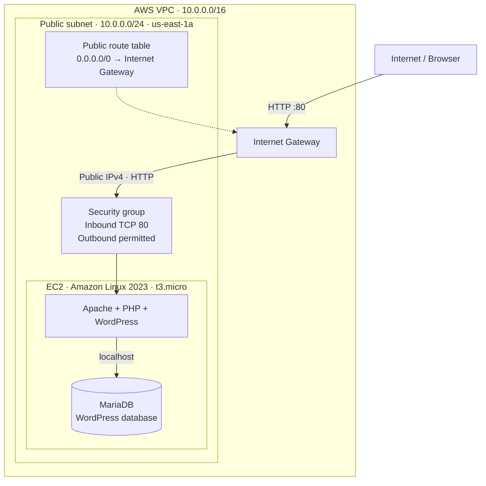

# Deploying WordPress on AWS with Terraform

A hands-on Infrastructure as Code project that provisions a publicly accessible WordPress website on AWS. Terraform creates the networking and EC2 infrastructure; EC2 user data installs and configures the application stack automatically.

## Architecture



*Architecture diagram — application and database share one public EC2 instance; the route table supplies the subnet's default internet route.*

The application runs on **one EC2 instance in one Availability Zone**. This is a learning deployment, not a highly available production architecture.


## Technologies

- **Terraform** — AWS infrastructure provisioning and outputs
- **AWS VPC** — custom VPC, public subnet, route table and Internet Gateway
- **Amazon EC2** — Amazon Linux 2023 host for the application
- **Security groups** — inbound HTTP and outbound connectivity
- **EC2 user data / cloud-init** — unattended server bootstrap
- **Apache, PHP, MariaDB and WordPress** — web server, application runtime, database and CMS

## Implementation

1. **Defined the Terraform provider and inputs.** The region, project name, instance type, VPC/subnet CIDRs, HTTP ingress CIDR and optional Availability Zone are configurable. The Amazon Linux 2023 AMI is resolved through AWS Systems Manager Parameter Store by default, rather than embedding a region-specific AMI ID.
2. **Created the networking layer.** Provisioned a custom VPC and public subnet, attached an Internet Gateway, created a default route (`0.0.0.0/0`) to the gateway and explicitly associated the route table with the public subnet.
3. **Configured instance access.** Created a security group permitting inbound TCP/80 from the configured CIDR, with outbound connectivity for updates and downloads. Launched a `t3.micro` EC2 instance with an auto-assigned public IPv4 address.
4. **Automated WordPress installation.** The `wordpress.sh` user data installs Apache, MariaDB, PHP and WordPress; creates a WordPress database and database user; generates a random database password and WordPress salts; writes `wp-config.php`; and applies filesystem permissions.
5. **Added resource ordering and outputs.** The instance explicitly depends on the public route table association and security group rules so the network configuration is created before bootstrapping begins. Terraform outputs the instance ID, public IP and website URL.
6. **Validated and deployed.** Ran `terraform init`, `terraform fmt`, `terraform validate`, `terraform plan` and `terraform apply`, then completed WordPress's browser-based setup wizard and verified the dashboard and homepage.

## Design decisions and trade-offs

| Decision | Rationale and trade-off |
|---|---|
| **Internet Gateway rather than NAT Gateway** | The EC2 instance lives in a public subnet and needs direct inbound HTTP and outbound access. A NAT Gateway is primarily for outbound access from private subnets and would add hourly and data-processing costs without benefiting this design. |
| **Single public EC2 instance** | Keeps the lab simple and relatively inexpensive. It is a single point of failure and exposes the host directly; production would typically use private application/database tiers and a load balancer. |
| **Auto-assigned public IPv4 instead of Elastic IP** | Avoids reserving a static address for a short-lived lab. The public IP can change when the instance is stopped and started, and AWS charges for public IPv4 addresses, including auto-assigned ones. |
| **Dynamic AMI lookup** | Avoids hardcoding an AMI ID that differs by AWS region. The latest image can change between deployments; pinning a known image would offer stronger reproducibility. |
| **Database on the same EC2 instance** | Minimises services and cost, but the database is not independently scalable or highly available. A production architecture could use Amazon RDS. |
| **Random database password generated at boot** | Avoids committing a static database password to Terraform code or GitHub. The password is stored locally in WordPress configuration; a production deployment should use dedicated secrets management and tighter filesystem ownership. |
| **HTTP rather than HTTPS** | Simplifies the assignment and confirms end-to-end connectivity. HTTP does **not** encrypt credentials or traffic; this deployment should not be used for real users or reused passwords. |
| **Explicit `depends_on`** | Ensures the relevant Terraform networking resources are created before EC2 is launched. It does not guarantee cloud-init has completed successfully. |

## Repository structure

```text
.
├── provider.tf                 # Provider and Terraform requirements
├── data.tf                     # AMI and Availability Zone lookups
├── variables.tf                # Configurable input definitions
├── terraform.tfvars.example    # Example deployment values
├── vpc.tf                      # VPC, subnet, gateway and routing
├── ec2.tf                      # EC2 and security group rules
├── outputs.tf                  # Instance ID, public IP and URL
├── wordpress.sh                # EC2 bootstrap script
├── screenshots/                # Deployment evidence
├── .gitignore
└── README.md
```

## Deploy it yourself

**Prerequisites:** Terraform, AWS credentials configured with sufficient permissions, and an AWS account. This deployment creates billable resources.

```bash
cp terraform.tfvars.example terraform.tfvars
# Review or edit terraform.tfvars for your AWS region and preferences
terraform init
terraform fmt
terraform validate
terraform plan
terraform apply
```

After applying, retrieve the URL with:

```bash
terraform output wordpress_url
```

Allow a few minutes for cloud-init to finish, then visit the URL and complete the WordPress installation wizard. Terraform finishing does **not** necessarily mean the application bootstrap has finished. For troubleshooting on the instance, inspect `sudo cloud-init status --long` and `sudo tail -n 60 /var/log/cloud-init-output.log`.

## Deployment verification

Terraform successfully created **9 resources**, with **0 changed and 0 destroyed**, and returned the EC2 instance ID, public IP and WordPress URL.


The EC2 instance was running in the WordPress VPC, with its instance checks passing.


The security group permitted inbound HTTP on TCP port 80. The screenshot shows the inbound rule; outbound access is defined in `ec2.tf`.


WordPress then loaded its installation wizard, administrator dashboard and public homepage, confirming the application was accessible after the Terraform refactor.


## Lessons learned

- **Provisioning is not application readiness.** Apache initially displayed its default “It works!” page while the user data script was still installing WordPress. Waiting for cloud-init and checking the application confirmed the deployment.
- **Dependencies matter.** Terraform infers many dependencies from resource references, but the instance also needed the public routing and security group rules ready before first-boot package downloads.
- **Clear naming improves maintainability.** Renamed assignment-specific resources to descriptive Terraform identifiers and consistent AWS tags, then redeployed to verify the refactor.
- **Make environment-specific values configurable.** Variables and data sources make the configuration easier to reuse without hardcoding an AMI, subnet ID or security group ID.

## Cleanup

To avoid ongoing charges, destroy the resources from the **same Terraform directory and state** used to deploy them:

```bash
terraform destroy
```

Confirm the plan before approving. Do not commit `.tfstate` files, `.terraform/`, local `terraform.tfvars`, credentials or secrets. The screenshots show a temporary lab environment; the displayed IP address may no longer be active.

